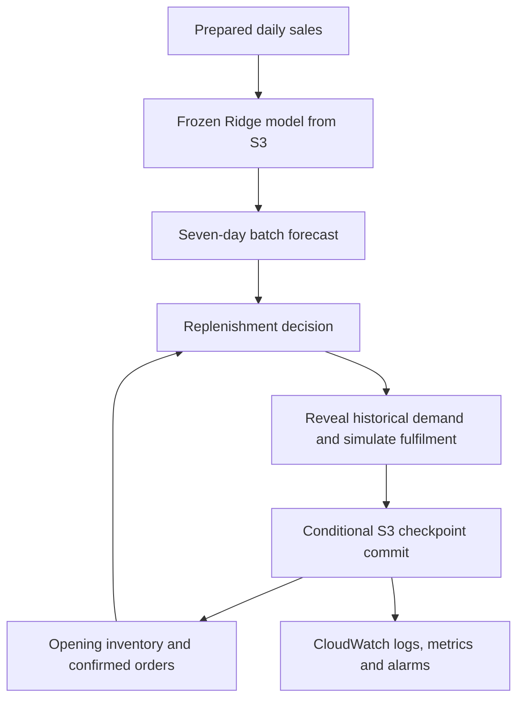

# Smart Stock: Demand Forecasting and Inventory Decisions on AWS

A single-product machine learning project that connects retail sales forecasting to simulated replenishment decisions, with batch inference, persistent inventory state, retry protection, and CloudWatch monitoring.

**Business question:** Can historical sales forecasts support replenishment decisions that balance the cost of lost sales against the cost of holding excess inventory?

The project evaluates two separate outcomes: forecast accuracy and inventory performance. A lower forecast error does not automatically imply a lower inventory cost.

## Portfolio overview

| Area | Implementation |
|---|---|
| Data | UCI Online Retail; product `22041`; daily sales as a proxy for demand |
| Forecasting | Seven direct Ridge models, one for each horizon from 1 to 7 days |
| Execution | Daily batch inference in an EC2 Python environment |
| Persistence | S3 model artifacts, versioned forecasts, decision evidence, and replay checkpoint |
| Replenishment | Daily order-up-to policy using forecasts, selected safety stock, on-hand stock, and confirmed pipeline |
| Automation | EC2 cron with a local lock and stable daily execution IDs |
| Monitoring | CloudWatch logs, custom metrics, dashboard, and alarms |
| Demonstration | Historical replay: one invocation advances one dataset day |

The repository includes the replay and monitoring implementations recovered from the project packages. A successful cloud execution, final evaluation tables, and the demonstration recording should be linked using the [release evidence checklist](docs/results.md). The presence of implementation code alone does not verify deployment status.

## From sales to a decision



At the beginning of simulated day *t*, the forecast uses sales observed through *t − 1*. Receipts are applied, the policy calculates an order, and only then is day *t* historical demand revealed. Unfulfilled units are treated as lost sales. No purchase orders are sent to suppliers.

A seven-day forecast is generated daily. Forecasts from different origins remain separate estimates. They are never added together across origins; the replay uses the run associated with its current decision.

## Modelling decisions

- Start with one product to validate the entire workflow before scaling.
- Use chronological development and evaluation periods.
- Select Ridge after comparing forecasting alternatives; retain a simple model suitable for limited product history.
- Train a separate model for each horizon. The deployed batch path uses direct forecasts, without feeding predictions back as observations.
- Reuse training feature functions during inference and check the model's feature contract and scikit-learn version.
- Keep the training cutoff at or before the forecast origin and exclude observations after the origin.
- Select inventory policy settings on validation data, then freeze them before a held-out comparison.

The replay package uses the May-trained validation candidate. It demonstrates integration and does not establish reproduction of the earlier final-model test results. See [evaluation and evidence](docs/results.md).

## Inventory policy

Daily review protects the period from *t* through *t + L*, including the review day. With a three-day lead time, the policy uses forecast horizons 1–4.

```text
inventory position = stock after today's receipts + remaining confirmed pipeline
order-up-to target = forecast sales over L + 1 days + selected safety stock
order quantity = pack size × ceil(max(0, target − inventory position) / pack size)
```

All confirmed outstanding quantities count in inventory position, matching the project simulator. Orders placed on day *t* arrive at the start of *t + L*.

Example replay assumptions are 28 initial units, a three-day lead time, pack size 1, holding cost 0.1 per unit per day, lost-sales cost 5 per unit, and fixed order cost 0. These are hypothetical simulation parameters, with no asserted currency or observed retailer cost.

## Reliability and monitoring

Forecast folders receive `_SUCCESS.json` only after their other artifacts are uploaded. Each includes predictions, feature snapshots, observed history, and a manifest with hashes and model metadata.

The replay commits inventory state, simulated orders, and its execution ledger in one conditional S3 checkpoint update. Reusing a committed execution ID returns a no-op. A new ID advances another historical day. Only day results referenced by the committed ledger should be aggregated.

CloudWatch reports operational health, inventory quantities, simulated costs, and forecast errors by horizon after target sales become available. A watchdog checks progress and heartbeat absence. CloudWatch is the operational view; the S3 checkpoint is the authoritative business record.

See [architecture](docs/architecture.md), [reproduction guide](docs/reproduction.md), and the [four-minute demonstration](docs/demo.md).

## Repository guide

| Path | Purpose |
|---|---|
| `notebooks/` | Existing exploration and forecasting work; feature notebook is currently empty |
| `scripts/train.py` | Fit the seven direct Ridge models and save the artifact metadata |
| `scripts/batch_forecast.py` | Validate inputs, generate forecasts, and publish a versioned S3 run |
| `scripts/replenish.py` | Produce a replenishment recommendation from a completed forecast |
| `scripts/daily_replay.py` | Orchestrate a historical day and commit the next inventory state |
| `scripts/cloudwatch_replay.py` | Run, probe, and watchdog monitoring modes |
| `scripts/setup_cloudwatch.py` | Create monitoring resources and generate publishing permissions |
| `scripts/*.sh` | EC2 scheduling wrappers |
| `config/*_example.json` | Example configuration and simulated startup stock |
| `docs/` | Architecture, reproduction, evaluation, and demo guidance |

## Limits and next steps

Historical sales are an imperfect proxy for demand: the dataset does not provide the stock availability needed to identify demand lost before sales were recorded. Inventory state, lead times, and costs are simulated. Findings are conditional on these assumptions and cannot be presented as verified commercial savings.

The current workflow is single-product and deterministic. It does not provide probabilistic forecasts, automated retraining, a model registry, supplier integration, or an always-available inference endpoint. EC2 must be running for cron to execute. Multi-product evaluation, uncertainty estimation, sensitivity analysis, and AWS-native orchestration remain extensions.

Data source: [UCI Online Retail](https://archive.ics.uci.edu/dataset/352/online+retail). Dataset redistribution and attribution should follow the source terms. No repository software licence has been selected in this documentation update.
